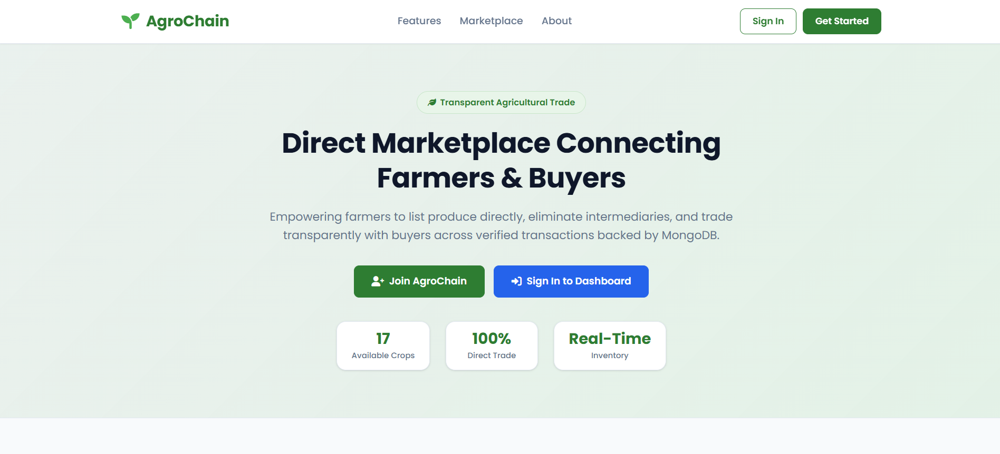
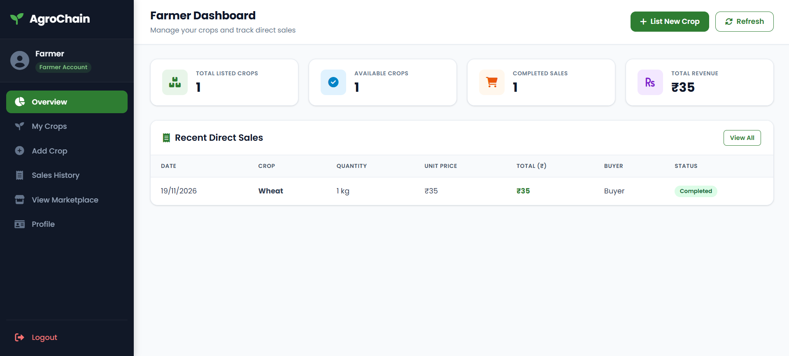
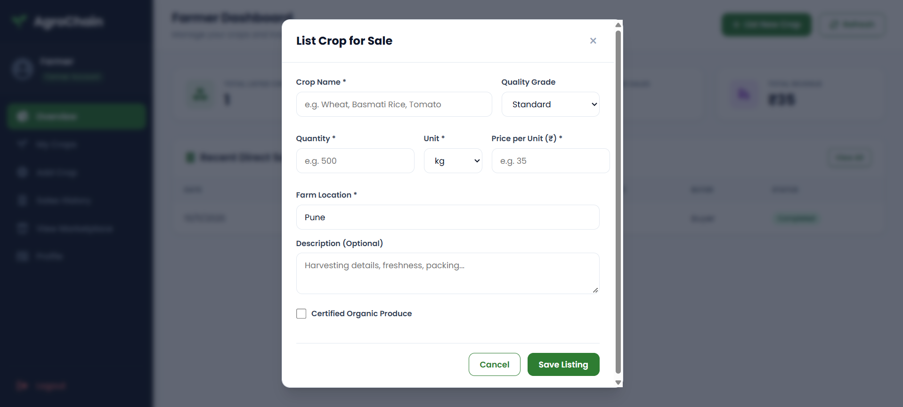
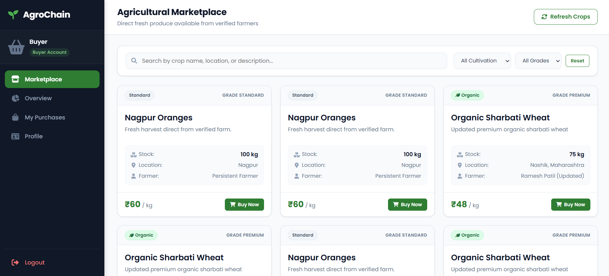
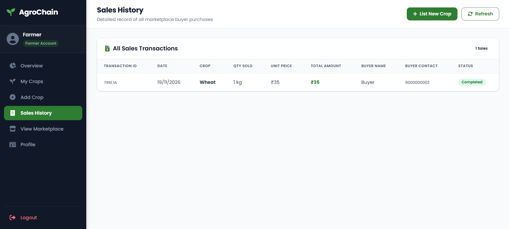

# 🌾 AgroChain — Agricultural Marketplace

A full-stack Agricultural Marketplace designed to connect farmers directly with buyers through a centralized web application. The system allows farmers to manage crop listings and enables buyers to browse, search, and purchase available agricultural products.

---

## 📌 Problem Statement

Traditional agricultural supply chains often involve multiple intermediaries between farmers and buyers. This can make product selling more difficult for farmers and can reduce transparency in the purchasing process.

**AgroChain** provides a centralized digital marketplace where farmers can list and manage their crops while buyers can directly browse and purchase available agricultural products.

---

## 🎯 Objectives

- Connect farmers and buyers through a common digital marketplace
- Provide secure user registration and login
- Allow farmers to manage crop listings
- Allow buyers to browse and search available crops
- Manage crop stock and availability
- Facilitate direct crop purchases
- Maintain transaction and purchase history
- Provide dashboards for monitoring marketplace activities
- Provide role-based access to different users
- Store application data using MongoDB

---

## ✨ Key Features

### 👨‍🌾 Farmer

- Farmer registration and login
- Farmer dashboard
- Add new crop listings
- View crop listings
- Update crop details
- Delete crop listings
- Manage available crop stock
- View sales and transaction history
- Manage profile information

### 🛒 Buyer

- Buyer registration and login
- Buyer dashboard
- Browse available crops
- Search and filter marketplace listings
- View crop details
- Purchase available crops
- Stock availability validation
- View purchase and transaction history
- Manage profile information

### 🔐 Authentication & Security

- JWT-based authentication
- Password hashing using bcrypt
- Role-based authorization
- Protected API routes
- User authentication middleware
- Crop ownership verification
- Prevention of self-purchase transactions

---

## 👥 User Roles

The system provides role-based access for:

- **Farmer**
- **Buyer**

Each role receives access to the functionality relevant to its responsibilities.

---

## 🧩 System Architecture

AgroChain follows a layered client-server architecture.

```text
                    ┌─────────────────────┐
                    │        User         │
                    │  Browser / Frontend │
                    └──────────┬──────────┘
                               │
                               │ HTTP / REST API
                               ▼
                    ┌─────────────────────┐
                    │       Express.js    │
                    │       Backend       │
                    ├─────────────────────┤
                    │ Routes              │
                    │ Controllers         │
                    │ Services            │
                    │ Middleware          │
                    │ Models              │
                    └──────────┬──────────┘
                               │
                               │ Mongoose
                               ▼
                    ┌─────────────────────┐
                    │       MongoDB       │
                    └─────────────────────┘
```

### Architecture Flow

```text
Frontend
   ↓
Routes
   ↓
Controllers
   ↓
Services
   ↓
Models
   ↓
MongoDB
```

- **Frontend:** Provides the user interface for farmers and buyers.
- **Routes:** Defines REST API endpoints.
- **Controllers:** Handles HTTP requests and responses.
- **Services:** Contains application and business logic.
- **Middleware:** Handles authentication and authorization.
- **Models:** Defines MongoDB data schemas using Mongoose.
- **MongoDB:** Stores users, crops, and transaction data.

---

## 🛠️ Technology Stack

### Frontend

- HTML
- CSS
- JavaScript

### Backend

- Node.js
- Express.js
- RESTful APIs

### Database

- MongoDB
- Mongoose

### Authentication & Security

- JSON Web Token (JWT)
- bcryptjs
- Validator

### Development Tools

- Visual Studio Code
- Node.js
- Nodemon
- Git
- GitHub
- PowerShell

---

## 🔐 Authentication & Authorization

AgroChain implements authentication and role-based authorization.

Users must authenticate before accessing protected functionality. JWT tokens are used to maintain authenticated sessions, while role-based authorization controls access according to whether the user is a **Farmer** or **Buyer**.

The backend also verifies ownership when farmers modify their crop listings.

---

## 📂 Project Structure

```text
AgroChain/
│
├── Backend/
│   ├── config/
│   │   └── db.js
│   │
│   ├── controllers/
│   │   ├── authController.js
│   │   ├── cropController.js
│   │   ├── dashboardController.js
│   │   ├── paymentController.js
│   │   └── transactionController.js
│   │
│   ├── middleware/
│   │   └── auth.js
│   │
│   ├── models/
│   │   ├── Crop.js
│   │   ├── Transaction.js
│   │   └── User.js
│   │
│   ├── routes/
│   │   ├── authRoutes.js
│   │   ├── buyerRoutes.js
│   │   ├── dashboardRoutes.js
│   │   ├── farmerRoutes.js
│   │   ├── marketplaceRoutes.js
│   │   ├── paymentRoutes.js
│   │   └── transactionRoutes.js
│   │
│   ├── services/
│   │   ├── authService.js
│   │   ├── cropService.js
│   │   ├── dashboardService.js
│   │   └── transactionService.js
│   │
│   └── app.js
│
├── Frontend/
│   ├── css/
│   ├── js/
│   ├── HTML pages
│   └── server.js
│
├── Snapshots/
│   ├── Homepage.png
│   ├── Dashboard.png
│   ├── Crop-Management.png
│   ├── Marketplace.png
│   └── Transactions.png
│
├── .env
├── .gitignore
├── package.json
└── README.md
```

---

## 🚀 How to Run

### Prerequisites

- Node.js
- MongoDB
- Git
- Web browser

### 1. Clone the Repository

```bash
git clone https://github.com/Shubham230305/AgroChain-A-Transperent-and-Direct-Marketplace-for-Farmers.git
```

### 2. Navigate to the Project Directory

```bash
cd AgroChain-A-Transperent-and-Direct-Marketplace-for-Farmers
```

### 3. Install Dependencies

```bash
npm install
```

### 4. Configure Environment Variables

Create a `.env` file in the project root and configure the required environment variables.

```env
PORT=8000
MONGODB_URI=your_mongodb_connection_string
JWT_SECRET=your_jwt_secret
```

Use your own MongoDB connection string and a secure JWT secret.

### 5. Start the Backend

```bash
npm start
```

For development with Nodemon:

```bash
npm run dev
```

The backend runs on the configured local port.

### 6. Access the Application

Open the frontend through the configured local frontend URL in your web browser.

---

## 📸 Interface Snapshots

### 🏠 Homepage



### 📊 Dashboard



### 🌱 Crop Management



### 🛒 Marketplace



### 💳 Transactions



---

## 🔄 Main Modules

- Authentication
- User Management
- Farmer Management
- Buyer Management
- Crop Management
- Marketplace
- Stock Management
- Purchase Management
- Transaction Management
- Dashboard
- Profile Management

---

## 🔄 Transaction Workflow

```text
Farmer
   │
   │ Add Crop
   ▼
Crop Listing
   │
   │ Available in Marketplace
   ▼
Buyer
   │
   │ Search / View Crop
   ▼
Purchase
   │
   ├── Check Stock
   ├── Verify Buyer
   └── Create Transaction
   │
   ▼
Transaction History
```

---

## 🔮 Future Scope

- Integration with a real online payment gateway
- Blockchain-based transaction verification
- IoT-based crop and environmental monitoring
- AI/ML-based market price prediction
- Mobile application for farmers and buyers
- SMS and email notifications
- Integration with government agricultural platforms
- Cloud deployment and scalability
- Advanced agricultural analytics
- Digital payment and settlement systems

---

## 📜 License

This project is developed for academic and educational purposes.

---

## 👨‍💻 Project

**AgroChain — Agricultural Marketplace**

A full-stack web application designed to provide a centralized platform for direct farmer-to-buyer agricultural transactions, crop management, marketplace operations, and transaction tracking.